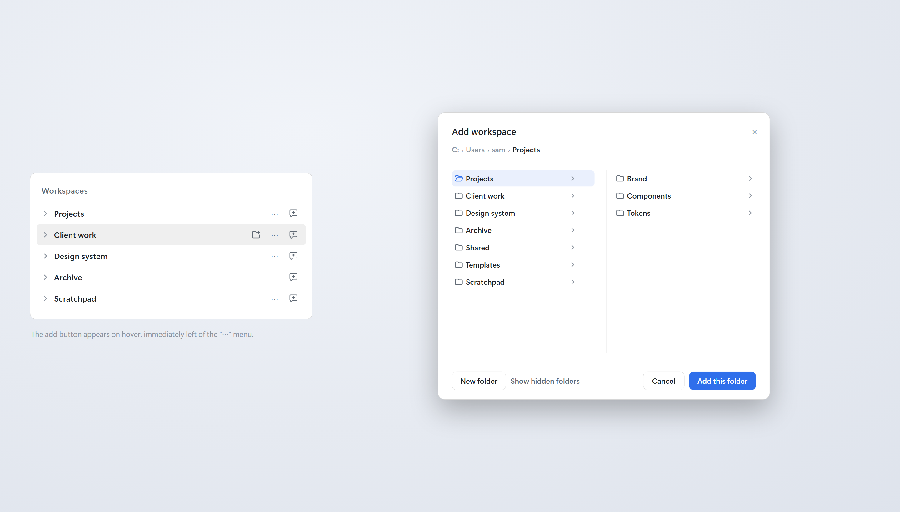
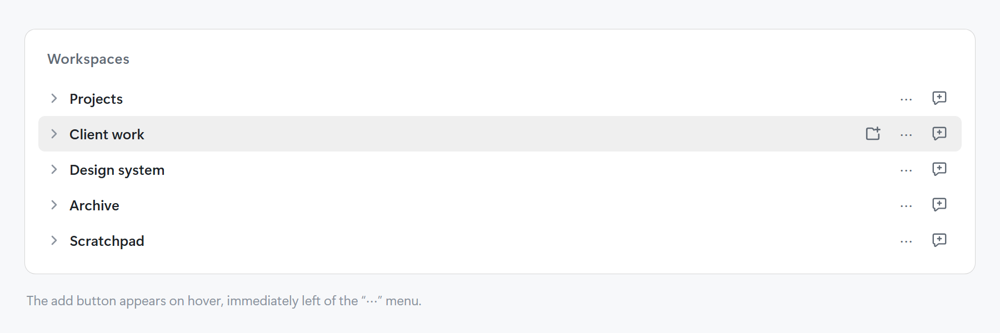
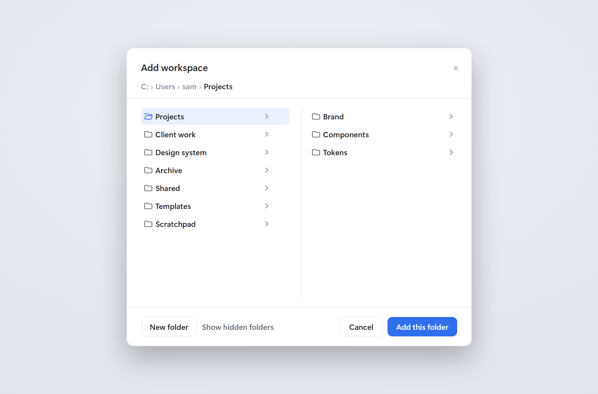
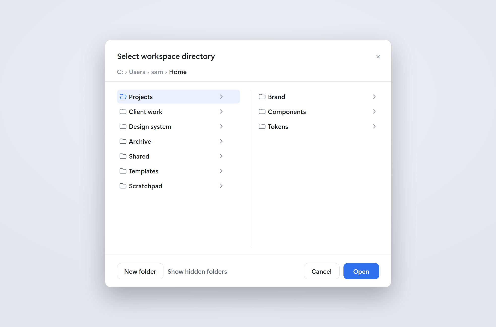

# @osman3n/dsh-workspace-browse-picker

In-app folder picker for Workspaces, plus a per-Workspace "add another workspace
from here" shortcut.



[English](README.md) · [简体中文](README.zh-CN.md)

## What it adds

1. **A hover button in every Workspace row**, immediately left of that row's
   `...` menu trigger. It appears only while the pointer is over the row (or
   while the button itself has focus), and it carries a folder-with-plus glyph.
   Clicking it opens a folder dialog **already sitting in that Workspace's own
   folder**, so `Basic` opens at `…\Projects\Basic`.
2. **An "Add workspace from this folder…" row** on the Workspace `...` menu.
   Same dialog and same starting folder; this is the upgrade-safe twin of the
   button.
3. **The dialog itself**: list subfolders, walk up through the breadcrumb,
   create a folder, then add the chosen folder as a Workspace and open a Session
   in it the way the shipped "Add workspace" flow does.
4. **The Workspace folder picker itself, restyled.** The three shipped
   directory-flow holes — `conversation.hero.workspace.directoryFlow`,
   `sidebar.workspaces.directoryFlow` and `workspace.picker.directoryFlow` — all
   render this bundle's dialog too, so every "Add workspace…" entry in the
   application opens the same in-app browser instead of the operating system's
   chooser.

## Screenshots

| | |
| --- | --- |
|  |  |
| The add button appears on hover, immediately left of `...`. | Adding a folder as a Workspace, already sitting in that folder. |
|  | |
| Every "Add workspace…" entry in the app opens this in-app browser. | |

## How the app-wide picker is covered without breaking it

Each directory-flow hole is a `single` cell, and a `single` cell renders the
first occupant in priority order (`priority` is a shadowing rank; lower runs
first). The shipped occupant sits at `priority: 0`, so this bundle registers at
`priority: -10` and simply outranks it:

```js
const flowInject = () => ({ listDirectory, createDirectory, pickDirectory })
for (const name of FLOW_SLOTS) {
  ctx.slots.inject(name, () =>
    ctx.slots.register({ name, priority: -10, locale: NS, inject: flowInject }, WorkspaceFlowEntry))
}
```

The replacement is **presentation-only**, and that is the whole point: the Host
keeps composing its own `directoryPicker` backend, so `directoryPickerController`
stays active and the OS chooser remains available everywhere (the dialog's
"Choose with system dialog…" button uses it). Nothing in `cordis.patch.yml`
disables a shipped row any more.

The dialog follows the shipped browser's design: the same `--dsw-alias-*`
tokens, the same two-pane Miller layout with the parent column, the divider and
the child column, the same 680×500 panel, 16px/510 title, 13px/510 row names,
0.5px `border-l3` separators, and a footer of `min-width: 72px` buttons. Only the
class prefix differs (`wbp-` instead of the shipped CSS-module hash), because the
shipped stylesheet and its primitives are not importable.

## Why the dialog is this bundle's own

The shipped directory browser always starts at the Host home directory. Its
owner contract, `DirectoryFlowOwnerProps`, is exactly `{ open, busy, onPicked,
onCancel, onError }` — there is **no seed-path field**, so the shipped browser
cannot be pointed at a chosen folder.

## Why the folder listing comes from this bundle's own Host routes

The shared folder seam is the abstract `directoryPicker` service, and the Host
composes it **once**:

- on a local Windows desktop, `@deepseek-ai/dsh-host-directory-picker-auto`
  composes the **native** backend, whose only capability is `pick`; `list` and
  `createDirectory` are refused, and
- `@deepseek-ai/dsh-api-workspace-controller` declares
  `static inject = ["directoryPicker"]`, so **removing or replacing the picker
  deactivates `directoryPickerController`** and breaks folder picking for the
  entire application (`directoryPicker/list: active Service
  directoryPickerController is unavailable`).

An earlier version of this bundle disabled the shipped `directory-picker` row to
mount the browse backend instead. That was the wrong trade: it silently broke
the app's own folder picker.

So `index.js` registers two routes on the Host web carrier
(`ctx.webServer.register`) and `client.js` calls them with plain same-origin
`fetch` — the same pattern `git-autobackup` uses:

| Route | Purpose |
| --- | --- |
| `GET /workspace-browse-picker/list?path=<absolute>` | One directory level: `{ path, home, crumbs, entries, truncated }` |
| `POST /workspace-browse-picker/create` `{ path, name }` | Create one folder, returns its absolute path |

Both answer `{ ok: true, value }` or `{ ok: false, message }`, only reply to a
loopback request, and refuse any path that is not absolute — checked on the
requested string *before* resolving, so a relative path can never silently
resolve against the Host's working directory.

The shipped native picker stays exactly as it was. When the browse dialog cannot
reach its routes at all, the dialog says so and offers "Choose with system
dialog…", which falls back to the shipped native chooser.

## How the row button is placed

The sidebar declares no action slot for Workspace rows — only Session rows get
one (`sidebar.workspaces.session.row.action`). The button is therefore a guarded
DOM insertion into the row's existing hover action strip:

- it is inserted immediately before that row's `[data-context-menu-trigger]`,
- it is re-added whenever the sidebar re-renders (`MutationObserver`) and pruned
  when its row or Workspace disappears,
- it refuses a trigger whose nearest `[data-row-key]` is a nested Session row,
  so a Session never gets a Workspace button,
- its reveal state is pure CSS on `[data-row-key^="workspace:"]:hover` /
  `:focus-within` with `opacity` (not `display`), so the row never shifts, and
  it stays visible on touch devices where hover does not exist.

Every DOM touch is wrapped in `try`/`catch`: a future sidebar restyle can make
the button disappear, but it cannot take the client down.

The button respects the ordinary Workspace-row reveal behaviour: hidden at rest,
revealed with the rest of the row's actions on hover.

## Settings

Nothing to configure.

## Disabling

Disable `@osman3n/dsh-workspace-browse-picker` in **Settings → Plugins**. This
bundle patches no shipped row, so disabling it restores the stock application
exactly.
