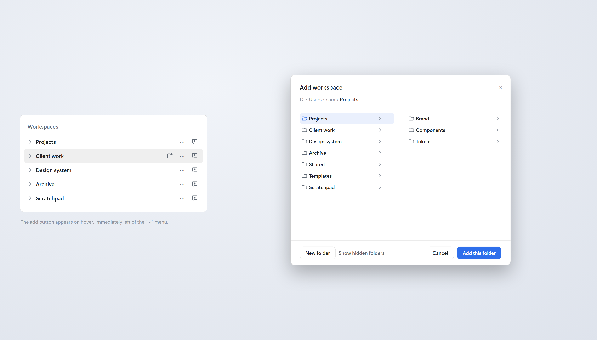
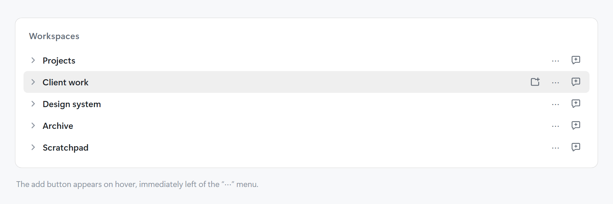
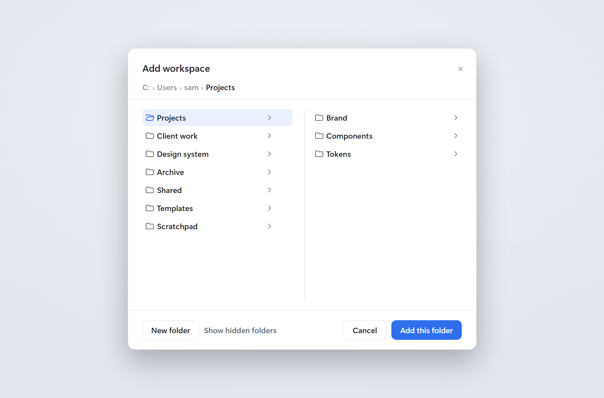
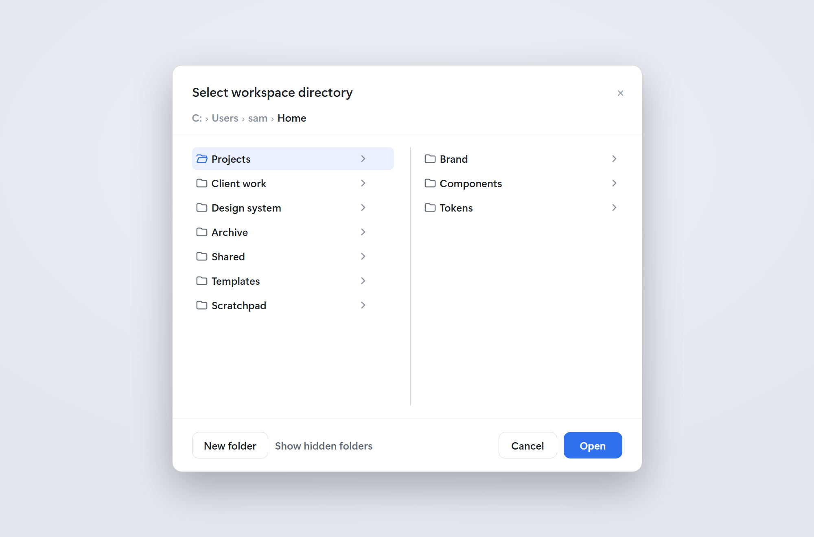

# @osman3n/dsh-workspace-browse-picker

工作区（Workspace）的应用内文件夹选择器，另外给每个工作区加了一个「从这里再添加一个工作区」的快捷入口。

[English](README.md) · [简体中文](README.zh-CN.md)



## 这个插件做了什么

1. **每个工作区行里多一个悬停按钮**，位置紧挨在该行 `...` 菜单的左边。只有在鼠标移到该行上（或按钮本身获得焦点）时才出现，图标是「文件夹 + 加号」。点它会打开文件夹对话框，并且**直接停在这个工作区自己的文件夹里**——比如在工作区 `Basic` 上点，就打开 `…\Projects\Basic`。

2. **工作区 `...` 菜单里多一行「Add workspace from this folder…」**。同一个对话框，同一个起始文件夹；这是那个悬停按钮的等价入口，对界面改版更稳健。

3. **对话框本身**：列出子文件夹、用面包屑往上走、新建文件夹，然后把选中的文件夹添加为工作区，并按内置「添加工作区」流程的方式在其中开一个会话。

4. **工作区文件夹选择器本身换了外观**。内置的三个目录流插槽——`conversation.hero.workspace.directoryFlow`、`sidebar.workspaces.directoryFlow`、`workspace.picker.directoryFlow`——都会渲染本插件的对话框，因此应用里每一处「Add workspace…」都会打开这个应用内浏览器，而不是操作系统自带的文件夹选择框。

## 截图

| | |
| --- | --- |
|  |  |
| 添加按钮只在悬停时出现，紧贴 `...` 左侧。 | 已经把目录定位在该文件夹里，再把它添加为工作区。 |
|  | |
| 应用里每一处「Add workspace…」都打开这个应用内浏览器。 | |

## 接管全局选择器，但不把它弄坏

每个目录流插槽都是一个 `single` 单元格，而 `single` 单元格渲染的是优先级顺序里的第一个占位者（`priority` 是遮蔽等级，数值越小越靠前）。内置占位者的优先级是 `0`，所以本插件注册 `priority: -10`，直接排在它前面：

```js
const flowInject = () => ({ listDirectory, createDirectory, pickDirectory })
for (const name of FLOW_SLOTS) {
  ctx.slots.inject(name, () =>
    ctx.slots.register({ name, priority: -10, locale: NS, inject: flowInject }, WorkspaceFlowEntry))
}
```

关键在于**这只是一次外观层的替换**：Host 端仍然按自己的方式组合 `directoryPicker` 后端，所以 `directoryPickerController` 依旧可用，操作系统选择框在任何地方都还在（对话框里的「Choose with system dialog…」按钮用的就是它）。`cordis.patch.yml` 里不再禁用任何内置条目。

对话框沿用内置浏览器的设计：同一套 `--dsw-alias-*` 令牌，同样的双栏 Miller 布局（父列、分隔线、子列），同样的 680×500 面板、16px/510 标题、13px/510 行名、0.5px 的 `border-l3` 分隔线，以及 `min-width: 72px` 的底部按钮。唯一的区别是类名前缀（`wbp-`，而不是内置的 CSS Module 哈希），因为内置样式表和它的基础组件无法被其它插件导入。

## 为什么对话框要自己写

内置的目录浏览器永远从 Host 的家目录开始。它的 owner 契约 `DirectoryFlowOwnerProps` 精确地只有 `{ open, busy, onPicked, onCancel, onError }`——**没有任何「起始路径」字段**，所以无法把它指向某个指定文件夹。

## 为什么目录列表由本插件自己的 Host 路由提供

共享的目录接缝是抽象的 `directoryPicker` 服务，而 Host 只会组合**一次**：

- 在本机 Windows 桌面上，`@deepseek-ai/dsh-host-directory-picker-auto` 组合的是 **native** 后端，它唯一的能力是 `pick`；`list` 与 `createDirectory` 会被拒绝；
- 而 `@deepseek-ai/dsh-api-workspace-controller` 声明了 `static inject = ["directoryPicker"]`，所以**移除或替换选择器会让 `directoryPickerController` 失效**，进而破坏整个应用的文件夹选择（报错为 `directoryPicker/list: active Service directoryPickerController is unavailable`）。

本插件的早期版本曾禁用内置 `directory-picker` 条目、改挂 browse 后端。那是一笔亏本交易：它在用户毫无察觉的情况下弄坏了应用自己的文件夹选择器。

所以现在的做法是：`index.js` 在 Host 的 Web 载体上注册两个路由（`ctx.webServer.register`），`client.js` 用同源的普通 `fetch` 调用它们——与 `git-autobackup` 完全相同的模式：

| 路由 | 用途 |
| --- | --- |
| `GET /workspace-browse-picker/list?path=<绝对路径>` | 读一层目录：`{ path, home, crumbs, entries, truncated }` |
| `POST /workspace-browse-picker/create` `{ path, name }` | 新建一个文件夹，返回其绝对路径 |

两者都返回 `{ ok: true, value }` 或 `{ ok: false, message }`，只响应本机回环请求，并拒绝任何非绝对路径——检查的是**请求里的原始字符串**，然后才做解析，因此相对路径绝不会悄悄被按 Host 工作目录解析掉。

内置的 native 选择器保持原样。如果对话框完全够不到自己的路由，它会如实说明，并给出「Choose with system dialog…」，退回到内置的选择框。

## 行内按钮是怎么放进去的

侧边栏并没有给工作区行声明任何操作插槽——只有会话行才有（`sidebar.workspaces.session.row.action`）。因此这个按钮是对该行既有悬停操作区的一次受控 DOM 插入：

- 插在该行 `[data-context-menu-trigger]` 的前一个位置；
- 侧边栏重渲染时重新补上（`MutationObserver`），所在行或工作区消失时清理掉；
- 如果触发按钮最近的 `[data-row-key]` 是嵌套的会话行，就不插，因此会话行永远不会长出工作区按钮；
- 显隐完全靠 CSS 的 `[data-row-key^="workspace:"]:hover` / `:focus-within` 配 `opacity`（不是 `display`），所以行永远不会跳动；在没有 hover 的触摸设备上则保持常显。

所有 DOM 操作都包在 `try`/`catch` 里：将来侧边栏改版最多让按钮消失，不会把客户端拖垮。

## 设置

无需配置。

## 停用

在 **设置 → 插件** 里停用 `@osman3n/dsh-workspace-browse-picker` 即可。本插件不修改任何内置条目，所以停用后就完全恢复原生表现。
